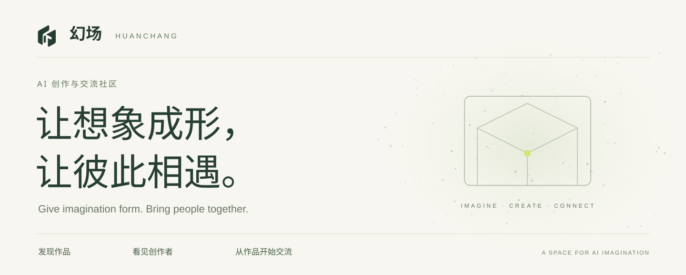
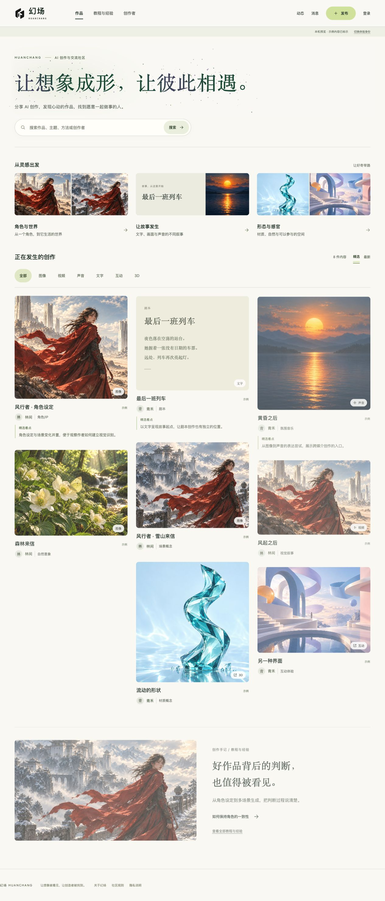
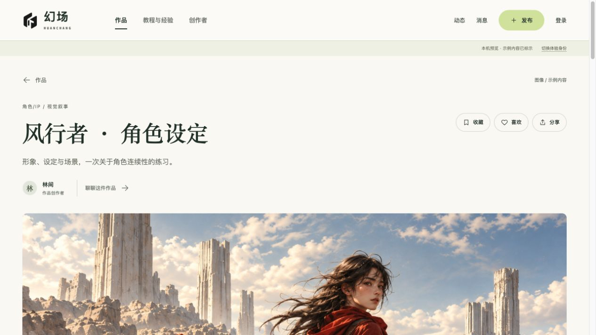
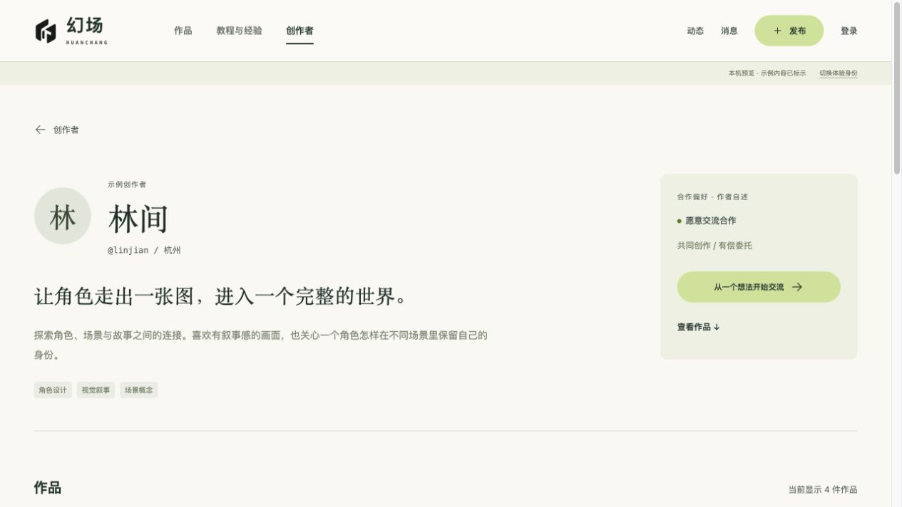

<p align="center"><strong>Discover AI-assisted work. Meet creative partners. Give imagination form together.</strong></p>
<p align="center"><a href="README.md">中文</a> · English · <a href="#why-huanchang">Purpose</a> · <a href="#what-you-can-do">Features</a> · <a href="#run-and-deploy">Run and deploy</a></p>

---

## Give imagination form. Bring people together.

**HUANCHANG / 幻场** is a work-sharing and conversation community for AIGC creators, people who appreciate their work, and people with a creative idea. It helps work be discovered and creators with different strengths find one another and begin creating together.

It is a place to build imagined worlds with AI, discover a compelling style or story, and meet the people who can bring an idea to life. A character, a screenplay, an image or a sound can become the beginning of a meaningful conversation.

> Share AI-assisted work. Discover something that moves you. Find people to create with.

## From one person's idea to a shared creation

A compelling work can bring together different creative strengths: writing and storytelling; concept art, characters and environments; directing and visual style; video production; editing and visual effects.

HUANCHANG aims to be a place where these strengths meet. Through portfolios, creative notes and profiles, people can discover one another's skills, share what they want to create together, and start a conversation around a specific idea. From the script and visual development to production and post-production, complementary abilities can help a shared vision become a more complete, compelling work.

## A look inside



<table><tr><td width="50%"></td><td width="50%"></td></tr><tr><td align="center">Understand skills and contributions through the work</td><td align="center">Discover complementary strengths and a reason to collaborate</td></tr></table>

Screenshots show labeled demo content, without real user profiles or private messages. They show a local build; a live URL will be added after deployment acceptance.

## Why HUANCHANG?

| Audience | The problem we want to address | Our approach |
| --- | --- | --- |
| Creators | Scattered posts make it difficult to communicate a consistent practice | Portfolios, featured work, creative notes and a personal profile |
| People seeking creative partners | A script, visual concept or production skill needs other strengths to become a complete work | Explore work and profiles, describe what you want to make together, and contact people with complementary skills |
| People exploring work | An inspiring image often loses its connection to its creator | Discover by theme, save work and follow the link to its author |
| People with a creative brief | A finished image alone does not explain fit or how to make contact | Read creative focus and availability; start a conversation from a specific work |
| Learners | Results are visible, but attempts and decisions are missing | Tutorials, process notes and discussions attached to the work |

These are product goals, not claims of proven market impact. Real usage and feedback will guide development.

## What you can do

**Discover creative work**

- Browse images, video, sound, writing, interactive work and 3D; search, filter and explore curated or recent posts.
- Explore themes such as characters and worlds, storytelling, materials and sensory experiences.
- Read editorial reasons and creative notes to understand expression, methods and contributions; discover directions to learn from or explore together.
- Like posts and keep a private collection.

**Present your work and what you can contribute**

- Publish work or tutorials with your contribution, AI involvement, process, discussion intent and usage boundaries. For shared work, describe collaborators' roles and contributions in the notes.
- Add up to eight images per post: 20 MB each and 60 MB total; arrange their order, write captions and crop the display image.
- Link external video, audio, interactive and 3D projects. User video/audio file hosting is not included.
- Edit your avatar, profile image, introduction, creative focus, featured work and collaboration preferences. Explain which stages you bring expertise to—writing, concept design, directing, video production, editing or visual effects—and what you can make with others.
- Manage drafts, published and removed posts; privately view your work's views, likes and saves.

**Find complementary partners and begin creating together**

- Follow a work to its creator's profile; use featured work, contributions and creative focus to understand what they could bring to a shared project.
- Use your work's discussion intent or profile introduction to describe your idea, what you want to complete and the skills you need. For example: “I have a short-film script and would like to explore character design and storyboards with another creator.”
- Discuss a specific question in comments, or attach a work to a private message. Explain your strengths, the help you need and what you want to create together.
- Recipients choose whether to respond. Participants can then discuss direction and roles. The first version supports discovering partners, initiating collaboration and staying in contact; production arrangements are agreed by the participants themselves.

**Keep conversations contextual and voluntary**

- Comment and reply on work; notifications link to the relevant discussion.
- Attach a work to a private message. Recipients choose whether to reply or close an unfamiliar contact.
- Load message history, review unread activity, block unwanted contact and report concerns.
- Administrators can review reports and manage content visibility and account status.

**Keep accounts and drafts usable**

- Register with a username and password. Email is optional; a phone number is not required.
- Verify an email or recover an account once a mail service is configured; recovery codes are also supported.
- Keep drafts when a session expires and return to the editor after signing in again.
- Server-side permissions protect private messages, collections and account email.

## Design principles

Work comes first. Creative contribution and process matter. Contact should have a concrete reason and respect the recipient's choice.

Complementary skills matter. Writing, visual development, directing, production, editing and effects can each be someone's strength. Real work and clear descriptions of those skills help people assess a potential collaboration and recognize each person's contribution.

Collaboration starts with a concrete idea: what already exists, which partners are needed, and what people want to complete together.

The first version provides free work discovery, skill presentation, partner discovery and communication. Payments, commissions, automatic matching, bilateral confirmation cards and private collaboration rooms are deferred.

Warm off-white, deep green and restrained lime accents frame a flexible work wall and readable detail pages. Starlight moves around the homepage title; reduced-motion preferences preserve a readable static title.

## Status

The local foundation has completed its current acceptance pass. The Vercel and Supabase adapter has passed its initial local regression; real cloud configuration and deployment acceptance are pending. The website currently has a Chinese interface. This repository introduction is bilingual.

## Run and deploy

The local preview needs Python's standard library only:

```sh
python3 huanchang_server.py --demo
```

Open `http://127.0.0.1:8790/#/works`. Demo identity switching is restricted to local previews and disabled in production.

```sh
python3 -m unittest tests.test_readiness -v
```

Target architecture: **GitHub for source → Vercel for pages and endpoints → Supabase for PostgreSQL and private image storage**. Existing username accounts and optional email remain; signed direct uploads keep large image bodies away from function requests.

See the [deployment guide](deployment/VERCEL-SUPABASE.md). Never commit live account databases, user uploads, credentials or private development backups.

## Feedback and contributions

Tell us about specific difficulties in finding partners or creating together: understanding someone's strengths and contributions, explaining the skills you need, or moving a conversation forward. These experiences will help determine which future collaboration features are useful.

Share reproducible bugs, concrete interaction feedback and improvements that solve a real problem. Include the page, steps, expected result and actual result. Do not include private messages, email addresses, verification codes or account data.

See [CONTRIBUTING](CONTRIBUTING.md) and [SECURITY](SECURITY.md).

## Code, brand and media rights

This repository makes its source visible while reserving rights to the project’s own code. No MIT, Apache, GPL or other open-source license is granted. Public visibility does not authorize modification, redistribution or commercial use; obtain permission from the relevant rights holder first. Brand assets and demo media are not automatically licensed with the code. Third-party libraries retain their own licenses. See [Rights notice](RIGHTS.md).

---

<p align="center"><strong>HUANCHANG · 幻场</strong><br />Let imagination be seen, and its creators be found.</p>
